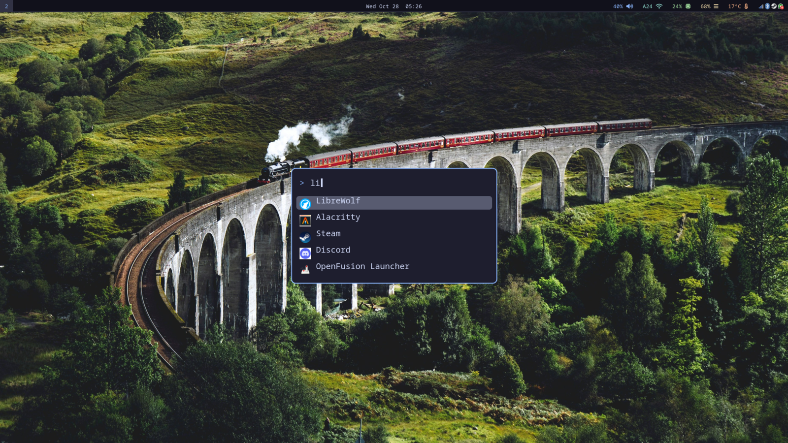
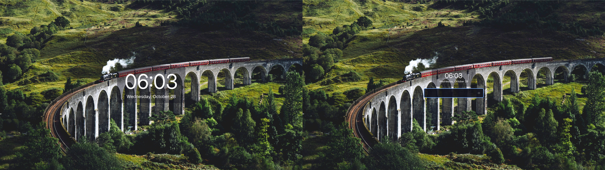
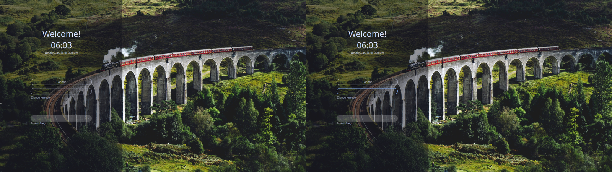

# Fedora Atomic Sway — Dotfiles

Personal dotfiles and UI design for **Fedora Atomic (Sway edition)** — a Catppuccin-Mocha-accented rice with a matching lock screen and login screen.

## Screenshots

| Desktop | Lock Screen | Login Screen |
|---------|-------------|--------------|
|  |  |  |

## What's inside

```
.
├── .config/
│   ├── sway/
│   │   ├── config                    # main Sway config (bindings, wallpaper)
│   │   └── config.d/
│   │       ├── 20-custom.conf        # outputs, pointer, fuzzel, Super+P screenshot
│   │       ├── 90-swayidle.conf      # idle/suspend locking via gtklock (overrides system swaylock)
│   │       └── 90-bar.conf           # waybar autostart
│   ├── gtklock/
│   │   └── style.css                 # lock screen design (Catppuccin Mocha, wallpaper bg)
│   ├── fuzzel/fuzzel.ini             # app launcher
│   └── waybar/                       # status bar (config + style)
├── .local/bin/
│   ├── screenshot-focused.sh         # Super+P → screenshot focused monitor
│   └── game-sleep-inhibitor.sh       # inhibits sleep while games run
├── sddm/                             # customized Sugar login theme
│   ├── apply-sddm.sh                 # installs theme + wallpaper + activation
│   ├── theme/                        # Sugar 1.6 (Qt6-ported, Catppuccin-colored)
│   ├── etc-sddm.conf.d/10-theme.conf # [Theme] Current=sugar
│   └── wallpaper.jpg                 # login background (same as desktop)
├── screenshots/                      # shots of the desktop / lock / login
├── flatpaks.txt                      # installed Flatpak apps
├── rpm-ostree-status.txt             # layered packages on the Atomic image
└── .bashrc
```

## The three layers

- **Desktop** — Sway with swaybg wallpaper, waybar, fuzzel launcher.
- **Lock screen** — `gtklock` styled with `~/.config/gtklock/style.css`:
  wallpaper background + dark rounded password box with a blue border.
  One single `swayidle` config (`90-swayidle.conf`) locks after 5 min idle and
  before suspend, and overrides the system default (which would otherwise show
  a plain black `swaylock` at the same timeouts — the classic "sometimes my
  lock looks different" bug).
- **Login screen** — SDDM running the **Sugar** theme, patched for Qt6 and
  restyled with the same wallpaper and Catppuccin Mocha colors
  (blue `#89b4fa`, base `#11111b`, text `#cdd6f4`).

## Installation

### Requirements

```bash
# layered on the Atomic image (see rpm-ostree-status.txt)
sudo rpm-ostree install gtklock swayidle grim grimshot waybar fuzzel python3
```

### User config

```bash
git clone git@github.com:ConnorEMcclanahan/dotfiles.git ~/dotfiles
cp -r ~/dotfiles/.config/* ~/.config/
cp -r ~/dotfiles/.local/bin/* ~/.local/bin/
```

Reload Sway: `Super+Shift+C` (or log out and back in).

### Login theme (needs sudo)

```bash
sudo bash ~/dotfiles/sddm/apply-sddm.sh
```

This installs the theme into `/usr/local/share/sddm/themes/sugar` (writable on
Fedora Atomic — `/usr/share` is read-only), copies the wallpaper where the
greeter user can read it, and activates the theme via
`/etc/sddm.conf.d/10-theme.conf`. It takes effect at the next login.

### Notes on the Sugar theme patches

Sugar 1.6 is a Qt5-era SDDM theme; Fedora's SDDM is Qt6. These fixes are
already applied in this repo's copy:

- `import QtGraphicalEffects 1.0` → `import Qt5Compat.GraphicalEffects`
- `property Control …` → `property var …` (Qt6 rejects assigning ComboBox to Control)
- Removed the Qt5-style `Button` icon indicators (Qt6 drew a dark box around them)
- VirtualKeyboard component stubbed (module not installed)
- Shader-based blur/shadows replaced with plain QML (no black-box artifacts)

## Screenshot keybinding

`Super+P` saves the focused monitor to `~/Pictures/screenshot.png`
(`.local/bin/screenshot-focused.sh`).

